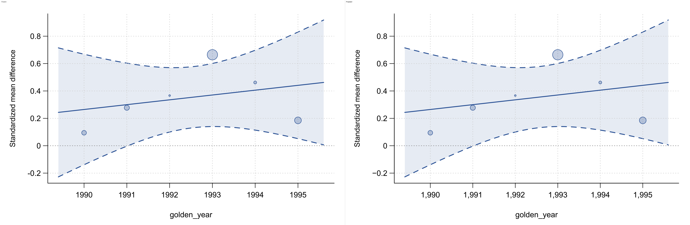
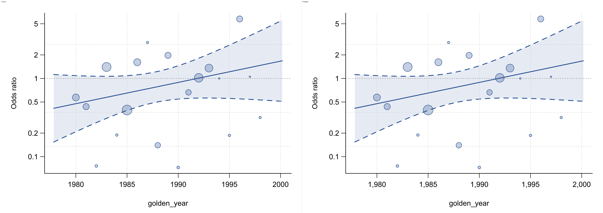
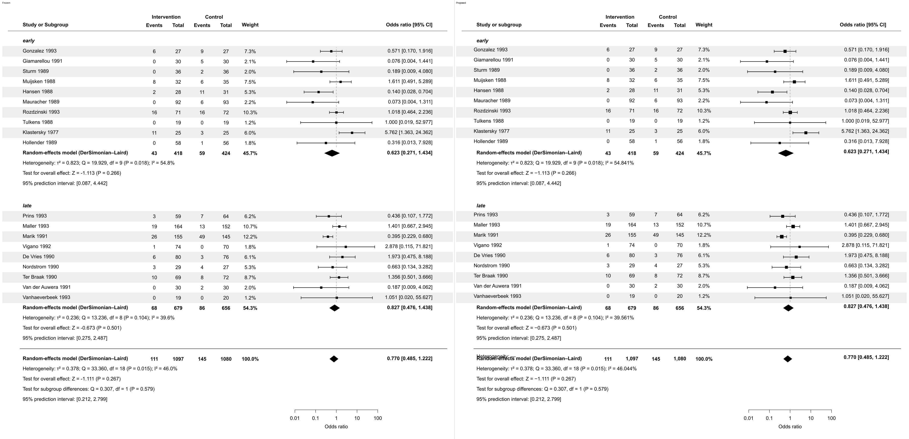

# Frozen presentation review

The frozen comparison passed all 416 numerical fields in both captures. The archive update uses the second capture. It retains the numerical oracle and its tolerances.

The branch originally proposed 18 changes. The final capture proposes 22, of which 4 are additional case and output pairs.

## Original 18 proposed changes

### 1. amino-binary-cumulative · Cumulative forest plot


### 2. amino-binary-cumulative · Cumulative summary

```diff
--- frozen
+++ proposed
@@ -2,24 +2,24 @@
 
 Metric: Odds ratio
 
-Model Results
- Study added (k)                Estimate  Lower bound (95% CI)  Upper bound (95% CI)  SE (log scale)  p-value
- Gonzalez, 1993 (k = 1)            0.571                 0.170                 1.916           0.617    0.365
- Prins, 1993 (k = 2)               0.509                 0.204                 1.273           0.467    0.149
- Giamarellou, 1991 (k = 3)         0.430                 0.180                 1.032           0.446    0.059
- Maller, 1993 (k = 4)              0.657                 0.268                 1.609           0.457    0.358
- Sturm, 1989 (k = 5)               0.614                 0.265                 1.422           0.428    0.255
- Marik, 1991 (k = 6)               0.540                 0.275                 1.060           0.344    0.073
- Muijsken, 1988 (k = 7)            0.634                 0.334                 1.205           0.328    0.164
- Vigano, 1992 (k = 8)              0.668                 0.358                 1.246           0.318    0.205
- Hansen, 1988 (k = 9)              0.572                 0.305                 1.073           0.321    0.082
- De Vries, 1990 (k = 10)           0.646                 0.352                 1.188           0.310    0.160
- Mauracher, 1989 (k = 11)          0.594                 0.323                 1.095           0.312    0.095
- Nordstrom, 1990 (k = 12)          0.606                 0.345                 1.062           0.287    0.080
- Rozdzinski, 1993 (k = 13)         0.655                 0.398                 1.078           0.255    0.096
- Ter Braak, 1990 (k = 14)          0.706                 0.442                 1.127           0.239    0.145
- Tulkens, 1988 (k = 15)            0.712                 0.453                 1.121           0.231    0.143
- Van der Auwera, 1991 (k = 16)     0.696                 0.446                 1.086           0.227    0.110
- Klastersky, 1977 (k = 17)         0.775                 0.477                 1.258           0.247    0.302
- Vanhaeverbeek, 1993 (k = 18)      0.780                 0.486                 1.253           0.241    0.304
- Hollender, 1989 (k = 19)          0.770                 0.485                 1.222           0.236    0.267
+Cumulative results
+ Step  Study added            k  Estimate  Lower bound (95% CI)  Upper bound (95% CI)  SE (log scale)  p-value  I²   
+ 1     Gonzalez, 1993         1     0.571                 0.170                 1.916           0.617    0.365  —    
+ 2     Prins, 1993            2     0.509                 0.204                 1.273           0.467    0.149  0.0% 
+ 3     Giamarellou, 1991      3     0.430                 0.180                 1.032           0.446    0.059  0.0% 
+ 4     Maller, 1993           4     0.657                 0.268                 1.609           0.457    0.358  46.5%
+ 5     Sturm, 1989            5     0.614                 0.265                 1.422           0.428    0.255  38.5%
+ 6     Marik, 1991            6     0.540                 0.275                 1.060           0.344    0.073  49.0%
+ 7     Muijsken, 1988         7     0.634                 0.334                 1.205           0.328    0.164  52.1%
+ 8     Vigano, 1992           8     0.668                 0.358                 1.246           0.318    0.205  47.7%
+ 9     Hansen, 1988           9     0.572                 0.305                 1.073           0.321    0.082  51.8%
+ 10    De Vries, 1990        10     0.646                 0.352                 1.188           0.310    0.160  53.1%
+ 11    Mauracher, 1989       11     0.594                 0.323                 1.095           0.312    0.095  53.1%
+ 12    Nordstrom, 1990       12     0.606                 0.345                 1.062           0.287    0.080  48.4%
+ 13    Rozdzinski, 1993      13     0.655                 0.398                 1.078           0.255    0.096  47.0%
+ 14    Ter Braak, 1990       14     0.706                 0.442                 1.127           0.239    0.145  46.8%
+ 15    Tulkens, 1988         15     0.712                 0.453                 1.121           0.231    0.143  42.8%
+ 16    Van der Auwera, 1991  16     0.696                 0.446                 1.086           0.227    0.110  40.4%
+ 17    Klastersky, 1977      17     0.775                 0.477                 1.258           0.247    0.302  51.6%
+ 18    Vanhaeverbeek, 1993   18     0.780                 0.486                 1.253           0.241    0.304  48.6%
+ 19    Hollender, 1989       19     0.770                 0.485                 1.222           0.236    0.267  46.0%
```

### 3. amino-binary-leave-one-out · Leave-one-out forest plot


### 4. amino-binary-meta-regression · Regression Plot


### 5. amino-binary-meta-regression · Summary

```diff
--- frozen
+++ proposed
@@ -1,6 +1,6 @@
 Meta-Regression
 
-Metric: Odds Ratio
+Metric: Odds ratio
 
 Model overview
  Statistic                    Value               
@@ -16,22 +16,22 @@
  golden_year  Continuous; observed range 1980.00 to 1998.00                                                                                         
 
 Coefficient estimates (log scale)
- Covariate    Estimate  Lower bound (95% CI)  Upper bound (95% CI)  Std. error       z  p-value
- Intercept     -124.77               -302.24                 52.71      90.552  -1.378    0.168
- golden_year      0.06                 -0.03                  0.15       0.046   1.375    0.169
+ Covariate    Estimate  Lower bound (95% CI)  Upper bound (95% CI)  SE (log scale)  z       p-value
+ Intercept    −124.77   −302.24                              52.71          90.552  −1.378    0.168
+ golden_year  0.06      −0.03                                 0.15           0.046  1.375     0.169
 
 Residual heterogeneity
  Statistic                     Value
- Residual heterogeneity (t²)    0.34
- SE of t²                      0.306
- Residual heterogeneity (t)     0.58
+ Residual heterogeneity (τ²)    0.34
+ SE of τ²                      0.306
+ Residual heterogeneity (τ)     0.58
  Residual I²                   41.9%
  Residual H²                    1.72
  Heterogeneity explained (R²)  11.4%
 
 Model tests
  Test                         Statistic  df  p-value
- Overall moderators (Qₘ)       1.89   1    0.169
+ Overall moderators (Qₘ)           1.89   1    0.169
  Residual heterogeneity (Qₑ)      29.27  17    0.032
 
 Heterogeneity explained (R²) is the proportional reduction in estimated between-study heterogeneity relative to the corresponding model without moderators.
```

### 6. amino-binary-random · Forest plot


### 7. amino-binary-random · Summary

```diff
--- frozen
+++ proposed
@@ -12,7 +12,7 @@
 
 Test for overall effect
  Z       p-value
- -1.111    0.267
+ −1.111    0.267
 
 Prediction interval
  Lower bound (95% PI)  Upper bound (95% PI)
```

### 8. amino-binary-subgroup · Subgroup forest plot


### 9. continuous-cumulative · Cumulative forest plot


### 10. continuous-cumulative · Cumulative summary

```diff
--- frozen
+++ proposed
@@ -2,11 +2,11 @@
 
 Metric: Standardized mean difference
 
-Model Results
- Study added (k)        Estimate  Lower bound (95% CI)  Upper bound (95% CI)  SE (standardized scale)  p-value
- Carroll, 1997 (k = 1)     0.095                -0.264                 0.453                    0.183         
- Grant, 1981 (k = 2)       0.189                -0.059                 0.438                    0.127    0.136
- Peck, 1987 (k = 3)        0.232                 0.015                 0.449                    0.111    0.036
- Donat, 2003 (k = 4)       0.376                 0.091                 0.660                    0.145    0.010
- Stewart, 1990 (k = 5)     0.397                 0.169                 0.626                    0.116  < 0.001
- Young, 1995 (k = 6)       0.358                 0.152                 0.565                    0.105  < 0.001
+Cumulative results
+ Step  Study added    k  Estimate  Lower bound (95% CI)  Upper bound (95% CI)  SE (standardized scale)  p-value  I²   
+ 1     Carroll, 1997  1     0.095  −0.264                               0.453                    0.183    0.605  —    
+ 2     Grant, 1981    2     0.189  −0.059                               0.438                    0.127    0.136  0.0% 
+ 3     Peck, 1987     3     0.232  0.015                                0.449                    0.111    0.036  0.0% 
+ 4     Donat, 2003    4     0.376  0.091                                0.660                    0.145    0.010  67.4%
+ 5     Stewart, 1990  5     0.397  0.169                                0.626                    0.116  < 0.001  56.5%
+ 6     Young, 1995    6     0.358  0.152                                0.565                    0.105  < 0.001  58.0%
```

### 11. continuous-leave-one-out · Leave-one-out forest plot


### 12. continuous-meta-regression · Regression Plot



### 13. continuous-meta-regression · Summary

```diff
--- frozen
+++ proposed
@@ -1,6 +1,6 @@
 Meta-Regression
 
-Metric: Standardized Mean Difference
+Metric: Standardized mean difference
 
 Model overview
  Statistic                    Value               
@@ -16,22 +16,22 @@
  golden_year  Continuous; observed range 1990.00 to 1995.00                                                                                         
 
 Coefficient estimates
- Covariate    Estimate  Lower bound (95% CI)  Upper bound (95% CI)  Std. error       z  p-value
- Intercept      -69.90               -330.97                191.16     133.199  -0.525    0.600
- golden_year      0.04                 -0.10                  0.17       0.067   0.527    0.598
+ Covariate    Estimate  Lower bound (95% CI)  Upper bound (95% CI)  SE (standardized scale)  z       p-value
+ Intercept    −69.90    −330.97                             191.16                  133.199  −0.525    0.600
+ golden_year  0.04      −0.10                                 0.17                    0.067  0.527     0.598
 
 Residual heterogeneity
  Statistic                     Value
- Residual heterogeneity (t²)    0.05
- SE of t²                      0.055
- Residual heterogeneity (t)     0.22
+ Residual heterogeneity (τ²)    0.05
+ SE of τ²                      0.055
+ Residual heterogeneity (τ)     0.22
  Residual I²                   64.4%
  Residual H²                    2.81
  Heterogeneity explained (R²)   0.0%
 
 Model tests
  Test                         Statistic  df  p-value
- Overall moderators (Qₘ)       0.28   1    0.598
+ Overall moderators (Qₘ)           0.28   1    0.598
  Residual heterogeneity (Qₑ)      11.22   4    0.024
 
 Heterogeneity explained (R²) is the proportional reduction in estimated between-study heterogeneity relative to the corresponding model without moderators.
```

### 14. continuous-random · Forest plot


### 15. continuous-random · Summary

```diff
--- frozen
+++ proposed
@@ -16,6 +16,6 @@
 
 Prediction interval
  Lower bound (95% PI)  Upper bound (95% PI)
- -0.072                               0.789
+ −0.072                               0.789
 
 95% prediction interval: the underlying effect in a new study; this is not the confidence interval of the pooled estimate.
```

### 16. continuous-subgroup · Subgroup forest plot


### 17. continuous-subgroup · Subgroup summary

```diff
--- frozen
+++ proposed
@@ -16,9 +16,9 @@
 
 Prediction interval
  Subgroups       Lower bound (95% PI)  Upper bound (95% PI)
- Subgroup early                 0.055                 0.515
- Subgroup late                 -0.194                 0.983
- Overall                       -0.072                 0.789
+ Subgroup early  0.055                                0.515
+ Subgroup late   −0.194                               0.983
+ Overall         −0.072                               0.789
 
 Test of subgroup differences
  Test                      Statistic  df  p-value
```

### 18. lymph-diagnostic-random-dor · Diagnostic odds ratio forest plot


## Final proposed changes

### 1. amino-binary-cumulative · Cumulative forest plot


### 2. amino-binary-cumulative · Cumulative summary

```diff
--- frozen
+++ proposed
@@ -2,24 +2,24 @@
 
 Metric: Odds ratio
 
-Model Results
- Study added (k)                Estimate  Lower bound (95% CI)  Upper bound (95% CI)  SE (log scale)  p-value
- Gonzalez, 1993 (k = 1)            0.571                 0.170                 1.916           0.617    0.365
- Prins, 1993 (k = 2)               0.509                 0.204                 1.273           0.467    0.149
- Giamarellou, 1991 (k = 3)         0.430                 0.180                 1.032           0.446    0.059
- Maller, 1993 (k = 4)              0.657                 0.268                 1.609           0.457    0.358
- Sturm, 1989 (k = 5)               0.614                 0.265                 1.422           0.428    0.255
- Marik, 1991 (k = 6)               0.540                 0.275                 1.060           0.344    0.073
- Muijsken, 1988 (k = 7)            0.634                 0.334                 1.205           0.328    0.164
- Vigano, 1992 (k = 8)              0.668                 0.358                 1.246           0.318    0.205
- Hansen, 1988 (k = 9)              0.572                 0.305                 1.073           0.321    0.082
- De Vries, 1990 (k = 10)           0.646                 0.352                 1.188           0.310    0.160
- Mauracher, 1989 (k = 11)          0.594                 0.323                 1.095           0.312    0.095
- Nordstrom, 1990 (k = 12)          0.606                 0.345                 1.062           0.287    0.080
- Rozdzinski, 1993 (k = 13)         0.655                 0.398                 1.078           0.255    0.096
- Ter Braak, 1990 (k = 14)          0.706                 0.442                 1.127           0.239    0.145
- Tulkens, 1988 (k = 15)            0.712                 0.453                 1.121           0.231    0.143
- Van der Auwera, 1991 (k = 16)     0.696                 0.446                 1.086           0.227    0.110
- Klastersky, 1977 (k = 17)         0.775                 0.477                 1.258           0.247    0.302
- Vanhaeverbeek, 1993 (k = 18)      0.780                 0.486                 1.253           0.241    0.304
- Hollender, 1989 (k = 19)          0.770                 0.485                 1.222           0.236    0.267
+Cumulative results
+ Step  Study added            k  Estimate  Lower bound (95% CI)  Upper bound (95% CI)  SE (log scale)  p-value  I²     
+ 1     Gonzalez, 1993         1     0.571                 0.170                 1.916           0.617    0.365  —      
+ 2     Prins, 1993            2     0.509                 0.204                 1.273           0.467    0.149  0.000% 
+ 3     Giamarellou, 1991      3     0.430                 0.180                 1.032           0.446    0.059  0.000% 
+ 4     Maller, 1993           4     0.657                 0.268                 1.609           0.457    0.358  46.510%
+ 5     Sturm, 1989            5     0.614                 0.265                 1.422           0.428    0.255  38.503%
+ 6     Marik, 1991            6     0.540                 0.275                 1.060           0.344    0.073  49.039%
+ 7     Muijsken, 1988         7     0.634                 0.334                 1.205           0.328    0.164  52.138%
+ 8     Vigano, 1992           8     0.668                 0.358                 1.246           0.318    0.205  47.743%
+ 9     Hansen, 1988           9     0.572                 0.305                 1.073           0.321    0.082  51.799%
+ 10    De Vries, 1990        10     0.646                 0.352                 1.188           0.310    0.160  53.130%
+ 11    Mauracher, 1989       11     0.594                 0.323                 1.095           0.312    0.095  53.102%
+ 12    Nordstrom, 1990       12     0.606                 0.345                 1.062           0.287    0.080  48.433%
+ 13    Rozdzinski, 1993      13     0.655                 0.398                 1.078           0.255    0.096  47.031%
+ 14    Ter Braak, 1990       14     0.706                 0.442                 1.127           0.239    0.145  46.814%
+ 15    Tulkens, 1988         15     0.712                 0.453                 1.121           0.231    0.143  42.790%
+ 16    Van der Auwera, 1991  16     0.696                 0.446                 1.086           0.227    0.110  40.447%
+ 17    Klastersky, 1977      17     0.775                 0.477                 1.258           0.247    0.302  51.587%
+ 18    Vanhaeverbeek, 1993   18     0.780                 0.486                 1.253           0.241    0.304  48.600%
+ 19    Hollender, 1989       19     0.770                 0.485                 1.222           0.236    0.267  46.044%
```

### 3. amino-binary-leave-one-out · Leave-one-out forest plot


### 4. amino-binary-leave-one-out · Leave-one-out summary

```diff
--- frozen
+++ proposed
@@ -2,25 +2,25 @@
 
 Metric: Odds ratio
 
-Model Results
- Study omitted         Estimate  Lower bound (95% CI)  Upper bound (95% CI)  SE (log scale)  p-value
- All studies              0.770                 0.485                 1.222           0.236    0.267
- Gonzalez, 1993           0.783                 0.477                 1.285           0.253    0.332
- Prins, 1993              0.796                 0.489                 1.296           0.249    0.359
- Giamarellou, 1991        0.811                 0.513                 1.281           0.233    0.369
- Maller, 1993             0.715                 0.437                 1.172           0.252    0.184
- Sturm, 1989              0.791                 0.494                 1.265           0.240    0.327
- Marik, 1991              0.864                 0.543                 1.375           0.237    0.538
- Muijsken, 1988           0.724                 0.446                 1.175           0.247    0.191
- Vigano, 1992             0.750                 0.468                 1.200           0.240    0.230
- Hansen, 1988             0.851                 0.542                 1.336           0.230    0.484
- De Vries, 1990           0.724                 0.449                 1.166           0.243    0.184
- Mauracher, 1989          0.813                 0.515                 1.283           0.233    0.375
- Nordstrom, 1990          0.772                 0.474                 1.257           0.249    0.298
- Rozdzinski, 1993         0.738                 0.442                 1.231           0.261    0.244
- Ter Braak, 1990          0.726                 0.443                 1.189           0.252    0.204
- Tulkens, 1988            0.764                 0.476                 1.227           0.242    0.266
- Van der Auwera, 1991     0.791                 0.494                 1.265           0.240    0.327
- Klastersky, 1977         0.696                 0.458                 1.059           0.214    0.091
- Vanhaeverbeek, 1993      0.764                 0.476                 1.226           0.242    0.265
- Hollender, 1989          0.780                 0.486                 1.253           0.241    0.304
+Leave-one-out results
+ Study omitted          k  Estimate  Lower bound (95% CI)  Upper bound (95% CI)  SE (log scale)  p-value       I²
+ All studies           19     0.770                 0.485                 1.222           0.236    0.267  46.044%
+ Gonzalez, 1993        18     0.783                 0.477                 1.285           0.253    0.332  48.695%
+ Prins, 1993           18     0.796                 0.489                 1.296           0.249    0.359  48.065%
+ Giamarellou, 1991     18     0.811                 0.513                 1.281           0.233    0.369  45.139%
+ Maller, 1993          18     0.715                 0.437                 1.172           0.252    0.184  43.888%
+ Sturm, 1989           18     0.791                 0.494                 1.265           0.240    0.327  47.799%
+ Marik, 1991           18     0.864                 0.543                 1.375           0.237    0.538  33.819%
+ Muijsken, 1988        18     0.724                 0.446                 1.175           0.247    0.191  46.421%
+ Vigano, 1992          18     0.750                 0.468                 1.200           0.240    0.230  48.007%
+ Hansen, 1988          18     0.851                 0.542                 1.336           0.230    0.484  41.400%
+ De Vries, 1990        18     0.724                 0.449                 1.166           0.243    0.184  46.133%
+ Mauracher, 1989       18     0.813                 0.515                 1.283           0.233    0.375  44.819%
+ Nordstrom, 1990       18     0.772                 0.474                 1.257           0.249    0.298  48.998%
+ Rozdzinski, 1993      18     0.738                 0.442                 1.231           0.261    0.244  48.085%
+ Ter Braak, 1990       18     0.726                 0.443                 1.189           0.252    0.204  46.774%
+ Tulkens, 1988         18     0.764                 0.476                 1.227           0.242    0.266  49.013%
+ Van der Auwera, 1991  18     0.791                 0.494                 1.265           0.240    0.327  47.784%
+ Klastersky, 1977      18     0.696                 0.458                 1.059           0.214    0.091  33.234%
+ Vanhaeverbeek, 1993   18     0.764                 0.476                 1.226           0.242    0.265  49.002%
+ Hollender, 1989       18     0.780                 0.486                 1.253           0.241    0.304  48.600%
```

### 5. amino-binary-meta-regression · Regression Plot



### 6. amino-binary-meta-regression · Summary

```diff
--- frozen
+++ proposed
@@ -1,6 +1,6 @@
 Meta-Regression
 
-Metric: Odds Ratio
+Metric: Odds ratio
 
 Model overview
  Statistic                    Value               
@@ -13,25 +13,25 @@
 Model specification
  Term         Specification                                                                                                                         
  Intercept    Estimated effect at continuous moderator value zero and categorical reference levels; extrapolated beyond an observed continuous range
- golden_year  Continuous; observed range 1980.00 to 1998.00                                                                                         
+ golden_year  Continuous; observed range 1,980.00 to 1,998.00                                                                                       
 
 Coefficient estimates (log scale)
- Covariate    Estimate  Lower bound (95% CI)  Upper bound (95% CI)  Std. error       z  p-value
- Intercept     -124.77               -302.24                 52.71      90.552  -1.378    0.168
- golden_year      0.06                 -0.03                  0.15       0.046   1.375    0.169
+ Covariate    Estimate  Lower bound (95% CI)  Upper bound (95% CI)  SE (log scale)  z      p-value
+ Intercept    −124.77   −302.24                              52.71           90.55  −1.38    0.168
+ golden_year  0.06      −0.03                                 0.15            0.05  1.37     0.169
 
 Residual heterogeneity
- Statistic                     Value
- Residual heterogeneity (t²)    0.34
- SE of t²                      0.306
- Residual heterogeneity (t)     0.58
- Residual I²                   41.9%
- Residual H²                    1.72
- Heterogeneity explained (R²)  11.4%
+ Statistic                      Value
+ Residual heterogeneity (τ²)     0.34
+ SE of τ²                        0.31
+ Residual heterogeneity (τ)      0.58
+ Residual I²                   41.91%
+ Residual H²                     1.72
+ Heterogeneity explained (R²)  11.41%
 
 Model tests
  Test                         Statistic  df  p-value
- Overall moderators (Qₘ)       1.89   1    0.169
+ Overall moderators (Qₘ)           1.89   1    0.169
  Residual heterogeneity (Qₑ)      29.27  17    0.032
 
 Heterogeneity explained (R²) is the proportional reduction in estimated between-study heterogeneity relative to the corresponding model without moderators.
```

### 7. amino-binary-random · Forest plot


### 8. amino-binary-random · Summary

```diff
--- frozen
+++ proposed
@@ -7,16 +7,16 @@
  0.770                    0.485                 1.222    0.267
 
 Heterogeneity
- Q       df  p-value     I²     τ²
- 33.360  18    0.015  46.0%  0.378
+ Q       df  p-value       I²     τ²
+ 33.360  18    0.015  46.044%  0.378
 
 Test for overall effect
  Z       p-value
- -1.111    0.267
+ −1.111    0.267
 
 Prediction interval
  Lower bound (95% PI)  Upper bound (95% PI)
  0.212                                2.799
 
-Calculation scale: log - estimate: -0.262, lower: -0.724, upper: 0.200, std. error: 0.236
+Calculation scale: log - estimate: −0.262, lower: −0.724, upper: 0.200, std. error: 0.236
 95% prediction interval: the underlying effect in a new study; this is not the confidence interval of the pooled estimate.
```

### 9. amino-binary-subgroup · Subgroup forest plot



### 10. amino-binary-subgroup · Subgroup summary

```diff
--- frozen
+++ proposed
@@ -4,15 +4,15 @@
 
 Model Results
  Subgroups        k  Estimate  Lower bound (95% CI)  Upper bound (95% CI)  SE (log scale)  p-value  z-value
- Subgroup early  10     0.623                 0.271                 1.434           0.425    0.266   -1.113
- Subgroup late    9     0.827                 0.476                 1.438           0.282    0.501   -0.673
- Overall         19     0.770                 0.485                 1.222           0.236    0.267   -1.111
+ Subgroup early  10     0.623                 0.271                 1.434           0.425    0.266  −1.113 
+ Subgroup late    9     0.827                 0.476                 1.438           0.282    0.501  −0.673 
+ Overall         19     0.770                 0.485                 1.222           0.236    0.267  −1.111 
 
 Heterogeneity
- Subgroups            Q  df  p-value     I²     τ²
- Subgroup early  19.929   9    0.018  54.8%  0.823
- Subgroup late   13.236   8    0.104  39.6%  0.236
- Overall         33.360  18    0.015  46.0%  0.378
+ Subgroups            Q  df  p-value       I²     τ²
+ Subgroup early  19.929   9    0.018  54.841%  0.823
+ Subgroup late   13.236   8    0.104  39.561%  0.236
+ Overall         33.360  18    0.015  46.044%  0.378
 
 Prediction interval
  Subgroups       Lower bound (95% PI)  Upper bound (95% PI)
```

### 11. continuous-cumulative · Cumulative forest plot


### 12. continuous-cumulative · Cumulative summary

```diff
--- frozen
+++ proposed
@@ -2,11 +2,11 @@
 
 Metric: Standardized mean difference
 
-Model Results
- Study added (k)        Estimate  Lower bound (95% CI)  Upper bound (95% CI)  SE (standardized scale)  p-value
- Carroll, 1997 (k = 1)     0.095                -0.264                 0.453                    0.183         
- Grant, 1981 (k = 2)       0.189                -0.059                 0.438                    0.127    0.136
- Peck, 1987 (k = 3)        0.232                 0.015                 0.449                    0.111    0.036
- Donat, 2003 (k = 4)       0.376                 0.091                 0.660                    0.145    0.010
- Stewart, 1990 (k = 5)     0.397                 0.169                 0.626                    0.116  < 0.001
- Young, 1995 (k = 6)       0.358                 0.152                 0.565                    0.105  < 0.001
+Cumulative results
+ Step  Study added    k  Estimate  Lower bound (95% CI)  Upper bound (95% CI)  SE (standardized scale)  p-value  I²     
+ 1     Carroll, 1997  1     0.095  −0.264                               0.453                    0.183    0.605  —      
+ 2     Grant, 1981    2     0.189  −0.059                               0.438                    0.127    0.136  0.000% 
+ 3     Peck, 1987     3     0.232  0.015                                0.449                    0.111    0.036  0.000% 
+ 4     Donat, 2003    4     0.376  0.091                                0.660                    0.145    0.010  67.407%
+ 5     Stewart, 1990  5     0.397  0.169                                0.626                    0.116  < 0.001  56.543%
+ 6     Young, 1995    6     0.358  0.152                                0.565                    0.105  < 0.001  58.032%
```

### 13. continuous-leave-one-out · Leave-one-out forest plot


### 14. continuous-leave-one-out · Leave-one-out summary

```diff
--- frozen
+++ proposed
@@ -2,12 +2,12 @@
 
 Metric: Standardized mean difference
 
-Model Results
- Study omitted  Estimate  Lower bound (95% CI)  Upper bound (95% CI)  SE (standardized scale)  p-value
- All studies       0.358                 0.152                 0.565                    0.105  < 0.001
- Carroll, 1997     0.411                 0.202                 0.621                    0.107  < 0.001
- Grant, 1981       0.370                 0.126                 0.615                    0.125    0.003
- Peck, 1987        0.353                 0.113                 0.593                    0.122    0.004
- Donat, 2003       0.254                 0.093                 0.416                    0.082    0.002
- Stewart, 1990     0.337                 0.094                 0.580                    0.124    0.007
- Young, 1995       0.397                 0.169                 0.626                    0.116  < 0.001
+Leave-one-out results
+ Study omitted  k  Estimate  Lower bound (95% CI)  Upper bound (95% CI)  SE (standardized scale)  p-value       I²
+ All studies    6     0.358                 0.152                 0.565                    0.105  < 0.001  58.032%
+ Carroll, 1997  5     0.411                 0.202                 0.621                    0.107  < 0.001  52.387%
+ Grant, 1981    5     0.370                 0.126                 0.615                    0.125    0.003  64.319%
+ Peck, 1987     5     0.353                 0.113                 0.593                    0.122    0.004  66.283%
+ Donat, 2003    5     0.254                 0.093                 0.416                    0.082    0.002   0.000%
+ Stewart, 1990  5     0.337                 0.094                 0.580                    0.124    0.007  66.267%
+ Young, 1995    5     0.397                 0.169                 0.626                    0.116  < 0.001  56.543%
```

### 15. continuous-meta-regression · Regression Plot


### 16. continuous-meta-regression · Summary

```diff
--- frozen
+++ proposed
@@ -1,6 +1,6 @@
 Meta-Regression
 
-Metric: Standardized Mean Difference
+Metric: Standardized mean difference
 
 Model overview
  Statistic                    Value               
@@ -13,25 +13,25 @@
 Model specification
  Term         Specification                                                                                                                         
  Intercept    Estimated effect at continuous moderator value zero and categorical reference levels; extrapolated beyond an observed continuous range
- golden_year  Continuous; observed range 1990.00 to 1995.00                                                                                         
+ golden_year  Continuous; observed range 1,990.00 to 1,995.00                                                                                       
 
 Coefficient estimates
- Covariate    Estimate  Lower bound (95% CI)  Upper bound (95% CI)  Std. error       z  p-value
- Intercept      -69.90               -330.97                191.16     133.199  -0.525    0.600
- golden_year      0.04                 -0.10                  0.17       0.067   0.527    0.598
+ Covariate    Estimate  Lower bound (95% CI)  Upper bound (95% CI)  SE (standardized scale)  z      p-value
+ Intercept    −69.90    −330.97                             191.16                   133.20  −0.52    0.600
+ golden_year  0.04      −0.10                                 0.17                     0.07  0.53     0.598
 
 Residual heterogeneity
- Statistic                     Value
- Residual heterogeneity (t²)    0.05
- SE of t²                      0.055
- Residual heterogeneity (t)     0.22
- Residual I²                   64.4%
- Residual H²                    2.81
- Heterogeneity explained (R²)   0.0%
+ Statistic                      Value
+ Residual heterogeneity (τ²)     0.05
+ SE of τ²                        0.06
+ Residual heterogeneity (τ)      0.22
+ Residual I²                   64.35%
+ Residual H²                     2.81
+ Heterogeneity explained (R²)   0.00%
 
 Model tests
  Test                         Statistic  df  p-value
- Overall moderators (Qₘ)       0.28   1    0.598
+ Overall moderators (Qₘ)           0.28   1    0.598
  Residual heterogeneity (Qₑ)      11.22   4    0.024
 
 Heterogeneity explained (R²) is the proportional reduction in estimated between-study heterogeneity relative to the corresponding model without moderators.
```

### 17. continuous-random · Forest plot


### 18. continuous-random · Summary

```diff
--- frozen
+++ proposed
@@ -7,8 +7,8 @@
  0.358                    0.152                 0.565                    0.105  < 0.001
 
 Heterogeneity
- Q       df  p-value     I²     τ²
- 11.914   5    0.036  58.0%  0.037
+ Q       df  p-value       I²     τ²
+ 11.914   5    0.036  58.032%  0.037
 
 Test for overall effect
  Z      p-value
@@ -16,6 +16,6 @@
 
 Prediction interval
  Lower bound (95% PI)  Upper bound (95% PI)
- -0.072                               0.789
+ −0.072                               0.789
 
 95% prediction interval: the underlying effect in a new study; this is not the confidence interval of the pooled estimate.
```

### 19. continuous-subgroup · Subgroup forest plot


### 20. continuous-subgroup · Subgroup summary

```diff
--- frozen
+++ proposed
@@ -9,16 +9,16 @@
  Overall         6     0.358                 0.152                 0.565                    0.105  < 0.001    3.400
 
 Heterogeneity
- Subgroups            Q  df  p-value     I²     τ²
- Subgroup early   1.939   2    0.379   0.0%  0.000
- Subgroup late    8.209   2    0.016  75.6%  0.062
- Overall         11.914   5    0.036  58.0%  0.037
+ Subgroups            Q  df  p-value       I²     τ²
+ Subgroup early   1.939   2    0.379   0.000%  0.000
+ Subgroup late    8.209   2    0.016  75.636%  0.062
+ Overall         11.914   5    0.036  58.032%  0.037
 
 Prediction interval
  Subgroups       Lower bound (95% PI)  Upper bound (95% PI)
- Subgroup early                 0.055                 0.515
- Subgroup late                 -0.194                 0.983
- Overall                       -0.072                 0.789
+ Subgroup early  0.055                                0.515
+ Subgroup late   −0.194                               0.983
+ Overall         −0.072                               0.789
 
 Test of subgroup differences
  Test                      Statistic  df  p-value
```

### 21. lymph-diagnostic-random-dor · Diagnostic odds ratio forest plot


### 22. lymph-diagnostic-random-dor · Diagnostic odds ratio summary

```diff
--- frozen
+++ proposed
@@ -5,8 +5,8 @@
  9.648                    5.529                16.835  < 0.001
 
 Diagnostic Odds Ratio -Heterogeneity
- Q       df  p-value     I²     τ²
- 42.259  16  < 0.001  62.1%  0.704
+ Q       df  p-value       I²     τ²
+ 42.259  16  < 0.001  62.138%  0.704
 
 Diagnostic Odds Ratio -Test for overall effect (H₀: diagnostic odds ratio = 1)
  Z      p-value
```
