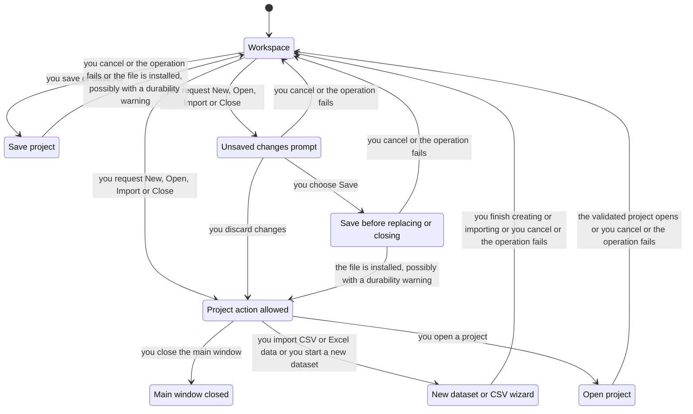
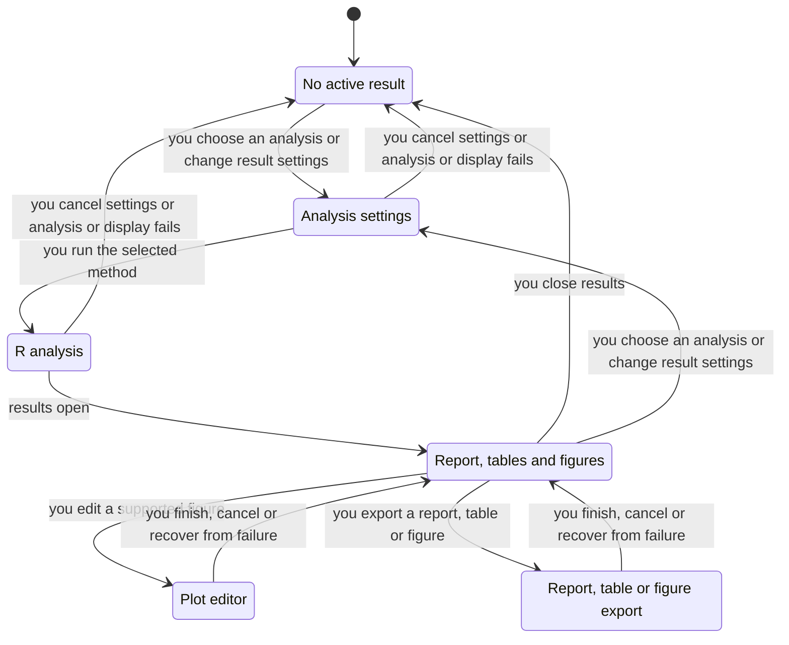

# RC MetaStudio app statecharts and formal verification

The app-wide lifecycle is represented by two projections of one finite model:
project/workspace operations and analysis/results operations. The save boundary
has a separate detailed safety model because destroying the last usable project
is costly and ordinary desktop runs rarely exercise failing I/O.

Open [the interactive charts](formal-verification/app-statecharts.html), or the
standalone SVGs: [projects](formal-verification/projects.svg),
[analyses/results](formal-verification/analysis.svg), and
[save safety](formal-verification/save.svg). The canonical rerun instructions and
code coverage record live in the [app-lifecycle skill](../.agents/skills/app-lifecycle/SKILL.md).

## Projects and workspace



The prompt branch applies to unsaved documents. The direct authorization branch
applies to empty/saved workspaces. The model retains this distinction even though
the chart labels both workspaces alike. Editing, study/outcome/follow-up/group
navigation, calculator acceptance, covariates, confidence/metric selection and
undo/redo are collapsed into workspace edits. Their internal validity and dirty
history are not proved here. Wizard pages, CSV/Excel preview and templates are
collapsed into one wizard boundary; Open also represents recent/startup paths.

## Analyses, results and plots



This projection tracks the currently followed analysis interaction. Existing
result windows can remain open when another project opens or a rerun starts;
`No active result` does not assert that all older windows disappeared. The model
has no result-window registry. The analysis region can progress independently of
document replacement: a result belongs to its analysis snapshot. That ownership
is a reviewed design fact, not an invariant proved by this model.

All supported dataset families (binary, continuous, diagnostic, generic, HR and
IRR), standard/sequential/subgroup/regression and small-study effects paths share
these macro phases. Estimator eligibility, inference, partial diagnostic success,
numerical results, R locking and plot transaction internals are abstracted. Report,
tables, figures, navigation, copy/zoom and export format choice are grouped. Help,
About/legal, theme and window placement are workspace/result self-steps, omitted
from the chart. A transition called cancel/failure is a macro return/recovery,
not a promise that running R can be asynchronously cancelled. Apply can repeat
inside the plot editor; Cancel returns to the last applied figure.

These are workflow charts for the whole app at operation boundaries, not an
exhaustive widget state machine or a proof that every UI flow succeeds. `App.tla`
checks absence of deadlock within this abstraction only. Terminal main-window
closure is an explicit stuttering action. Neither fairness nor eventual successful
analysis is asserted.

## Verified save boundary

TLC release 1.7.4 was chosen because save safety depends on the ordering of steps
and failures. The runner pins its SHA-256. The bounded model has one save operation,
one previous destination, one new archive, Boolean validation/installation and
ordinary exception failures. It explores every reachable state in that scope.
This is model checking, not a proof over Python or arbitrary filesystem behavior.

| Rule | User-facing promise | Real source boundary |
| --- | --- | --- |
| `PreservePrevious` | A failed operation before replacement preserves the previous project. | `save_project`: sibling temporary file, `os.replace`, `_cleanup_temporary` |
| `InstallOnlyValidated` | Only a reopened and validated temporary archive can replace the destination. | `save_project`: `load_project(temporary_path)` before `os.replace` |
| `ReportInstalled` | Failure after replacement is reported as durability uncertainty, not ordinary save failure. | `_fsync_parent_directory`: `ProjectDurabilityError` after directory open/sync/close errors |

The model's preparation steps hide input serialization, directory creation and
temporary-handle setup. They do not model these calls as physically indivisible;
they collapse internal steps which cannot change the destination. Write, flush,
file sync, temporary validation, replacement and directory confirmation are
separate failure boundaries. Temporary cleanup errors may leave a temporary file;
they must not damage the destination or hide the primary error. Existing replay
tests check this behavior, although temporary-file existence is outside the model.

Assumptions: one writer, no external file modification, same-directory atomic
replacement semantics and ordinary exceptions. Power loss/reboot durability,
process killing, malicious filesystem behavior, concurrent saves, arbitrary parser
inputs and UI bookkeeping failures are outside the proof. Native directory fsync
is unsupported on Windows; replay tests simulate directory descriptors to exercise
the production exception-handling path, not actual POSIX directory durability.

## Results and evidence — 2026-10-29

Code correspondence was reviewed at
`7f1057d626ce5b7e4a351ca4a1e80ad0062cd127`; no product code changed. Baseline:
251 reachable app states, 11 reachable save states, no deadlock, all three save
invariants hold, and eight existing real-code persistence fault tests pass.
The detailed source/function mapping and sync-update rule are in the skill.

The deliberate changes were applied only to retained scratch source copies:

| Scratch break | Shortest model path | Real-code replay |
| --- | --- | --- |
| Truncate destination before replacement | `PreservePrevious`: report steps 0–6, input → temporary → write → flush → sync → validation → replacement failure destroys previous file | 1 failed, 7 passed; the previous destination cannot be reopened |
| Skip temporary validation | `InstallOnlyValidated`: steps 0–5, input → temporary → write → flush → sync → unchecked replacement | 1 failed, 7 passed; the injected validation failure is bypassed |
| Change durability errors into ordinary format errors | `ReportInstalled`: steps 0–7, input → temporary → write → flush → sync → validation → replacement → directory failure reported as ordinary failure | 3 failed, 5 passed; installed-file errors have the wrong exception type |

Each property has therefore been observed failing, and each corresponding scratch
code defect was caught by an existing production-path test. These are deliberate
breaks, **not findings in the current app**. A clean baseline was rerun afterward.

Retained reports: [projects](formal-verification/projects-report.md),
[analyses](formal-verification/analysis-report.md),
[save](formal-verification/save-report.md),
[preservation counterexample](formal-verification/truncate-report.md),
[validation counterexample](formal-verification/skip-validation-report.md), and
[classification counterexample](formal-verification/misclassify-report.md).
The adjacent `*-replay.log` files retain real-code assertions.

Every new runner invocation keeps input models/configs, copied production source,
selected unchanged tests, exact commands, Python/Java identity, source revision,
JUnit, logs, temporary project files and hashes in its printed evidence folder.
Run from the repo root:

```powershell
uv run python .agents/skills/app-lifecycle/check.py
```

Initial full evidence is under this machine's temporary directory in
`rcms-formal-final-20261029`, `rcms-formal-truncate-20261029`,
`rcms-formal-skip-validation-20261029` and `rcms-formal-misclassify-20261029`.
The skill documents portable reruns and mutations. Read every model result with
pstack `/statechart`, generating a **new** output folder each time. It supplies
the current launcher command; use each run's copied model/config and the named
view modules. Do not treat the checked-in charts as evidence for later code.

On this Windows host the installed pstack 0.9.111 launcher requires `/bin/sh`,
which is absent, and its message parser fails on native Java CRLF markers
(`TLC exited 12 ... output names no rule that broke`). To produce reports, the
same installed worker/checker/chart pipeline was run directly, with `TLA2TOOLS`
pointing to the hash-checked jar. For mutation reports only, a scratch copy of
`frontends/messages.ts` stripped trailing `\r` from each input line. No invariant,
TLC command or production/plugin source was changed. Raw TLC and real-code runs
independently establish the results. Future agents should inspect their installed
`/statechart` version rather than assuming this workaround remains necessary.

Pele 1.9.0 rendered the generated Mermaid into the adjacent SVGs. The project
projection hides 467 self-label steps; the analysis projection hides 707; save
hides four terminal/self-label steps. No cross-label transitions were suppressed.
The views are deliberately separate to avoid a product graph of repeated copies
of the same screen. The exact generated Mermaid is retained in the adjacent
`.mmd` files, including the detailed save graph.

## Maintenance and consolidation

Repository search found only the existing `verify-rcms` skill and no earlier
project-local formal skill or TLA+ model. No skill needed deletion. Formal coverage
now has one owner, `app-lifecycle`, linked from `verify-rcms`; persistence replay
reuses eight existing tests rather than adding a duplicate suite. Keep desktop,
statistical and packaging checks under `verify-rcms`. Add later formal properties
to this skill's coverage record. Use `/maintain-formal-verification-skill` when
covered code has changed without rechecking correspondence.

The skill supplies an acceptance check for candidate changes: correspondence
review, the formal check, and links to real Qt/R checks in `verify-rcms`. The calling
task chooses improvements and controls iteration. Changes outside the formal model
still need real-app evidence. Passing this model alone does not establish app-wide
regression safety. Add formal coverage only when a concrete task needs it; plot
rollback remains outside the current formal checks.

## Executed skill check and harness repair

The generator changes are retained as
[`pstack-verification-generators.patch`](agents/pstack-verification-generators.patch),
relative to the pstack 0.9.111 plugin root. The installed generator files live
outside this repository; this patch preserves their exact changes for review and
reapplication. Both generators and both project skills pass `quick_validate.py`.
The patch reverse-checks cleanly against the installed edited generators.

The following runs exercised the existing skill instructions on Windows using
Python 3.11, Qt 6.11.1/PyQt 6.11.0, R 4.6.1, rpy2 3.6.7, and RCMetaR 0.5.0 installed
from this checkout into `build/verification/skill-proof-library`. Dependencies
were copied from the existing packaged library into that test-owned library and
checked against the pinned manifest; no system package was changed. Installed
source hashes and the exact R installation command are retained in
`artifacts/verification/skill-validation/r-source-provenance.json`.

| Command, from repository root | Observed result | Retained evidence |
| --- | --- | --- |
| `uv run python .agents/skills/app-lifecycle/check.py` | 251 app states, 11 save states; all three save invariants and eight production persistence checks pass | `%TEMP%/rcms-formal-e3aqsx6i` |
| Same command with `--mutation truncate` | `PreservePrevious` fails; one real-code assertion fails | `%TEMP%/rcms-formal-i71zwe77` |
| Same command with `--mutation skip-validation` | `InstallOnlyValidated` fails; one real-code assertion fails | `%TEMP%/rcms-formal-djolpuvq` |
| Same command with `--mutation misclassify` | `ReportInstalled` fails; three real-code assertions fail | `%TEMP%/rcms-formal-fignjikl` |
| `uv run python scripts/verify_rcms.py doctor` | Default offscreen startup passes with required Segoe UI glyphs and real R/package identity | `artifacts/verification/rcms/20261029T180817Z-9aa381a8-doctor` |
| `uv run python scripts/verify_rcms.py editing` | Edit/undo/redo/save/reopen and corrupt-open recovery pass; reopened data analyze through real R | `artifacts/verification/rcms/20261029T180823Z-c4680004-editing` |
| `uv run python scripts/verify_rcms.py plot-edit` | Apply changes real rendered output and persisted parameters; Cancel preserves the last applied figure | `artifacts/verification/rcms/20261029T180837Z-29739664-plot-edit` |
| `uv run python scripts/verify_rcms.py doctor --native` | Native Windows startup still passes with Segoe UI | `artifacts/verification/rcms/20261029T180930Z-cc65c426-doctor` |

For the desktop runs, `RCMS_QT6_BUILD_ROOT` selected `build/qt6-verification`,
`RCMS_R_HOME` selected `C:/Program Files/R/R-4.6.1`, and `RCMS_R_LIBS` selected the
test-owned library above. `uv sync --locked` and the skill's Qt generation command
completed before the successful runs. Full manifests retain the executed child
commands, inputs, screenshots, side effects and hashes. All recorded artifact
hashes were rechecked after teardown; each recorded application scratch directory
was absent. The audit is retained in
`artifacts/verification/skill-validation/evidence-audit.json`.

Running the default doctor exposed a harness bug: scanning every Windows font made
offscreen Qt choose Agency FB for its generic Sans Serif default. That face lacks
the required glyphs, so the existing doctor correctly failed. The harness now
copies Segoe UI regular/bold/italic faces into each run's owned font directory.
The default doctor and both real workflows passed after the fix. The fonts survive
as hashed evidence under `workflow/fonts`; scratch copies are removed. Native font
selection is unchanged. No application or statistical code changed.

The original failure is retained at
`artifacts/verification/rcms/20261029T180528Z-46485f38-doctor`. An explicit
`QT_QPA_FONTDIR=C:/Windows/Fonts` override still reproduces the glyph rejection at
`artifacts/verification/rcms/20261029T180924Z-4cdb1b72-doctor`, establishing that the
override is honored and the assertion was not weakened. These failed runs are not
counted as passes. An earlier startup attempt before resources were ready is also
retained at `artifacts/verification/rcms/20261029T175824Z-00721e92-doctor`.

This establishes that the skills' targeted formal and desktop verification paths
work and detect the demonstrated defects. It does not establish the complete
desktop matrix, all native UI/UX behavior, the independent numerical authority
matrix, or release-package qualification; those gates were not run for this
skill/harness change.
