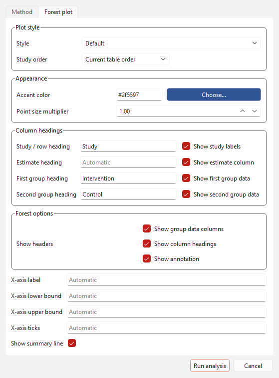
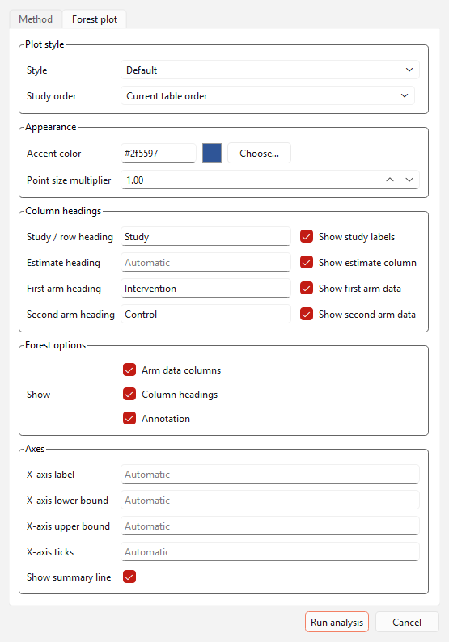
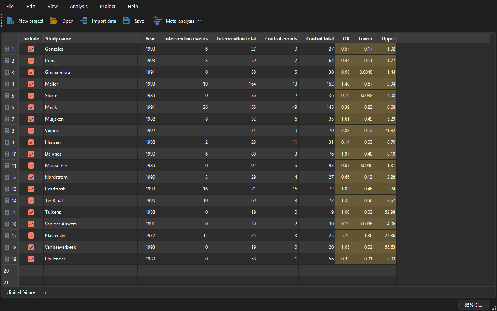
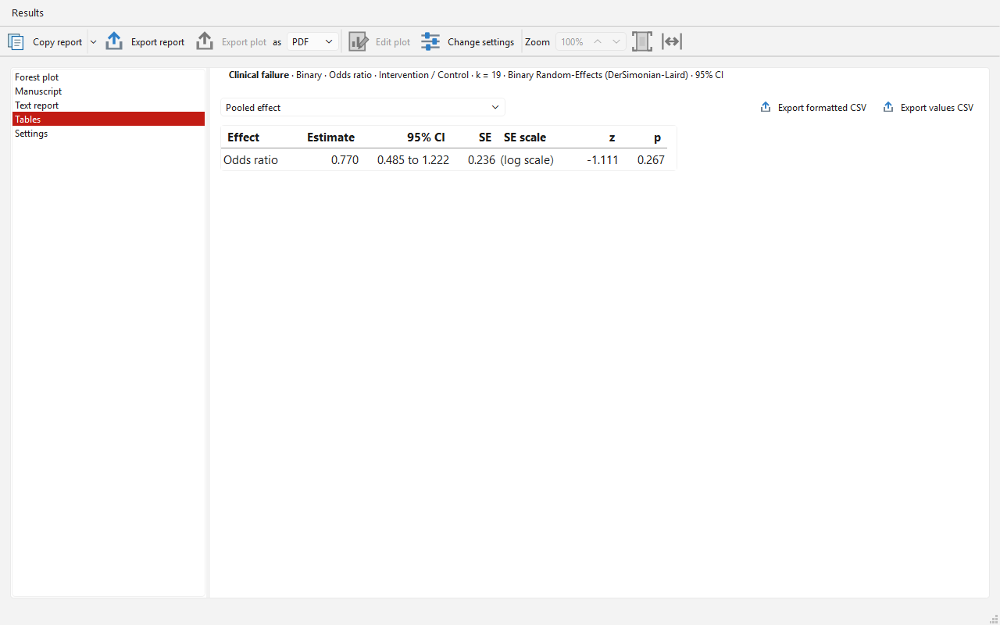
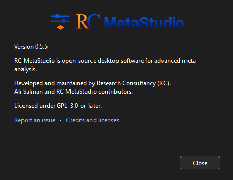

# Second UI refinement pass

Fable's directions are in `ui-refinement-pass2-fable-2026-11-16.md`. The first
implementation is commit `dbd42e1a`. Existing user decisions remain binding:
solid icons, plus/minus sequential-analysis symbols, upright numbers, original
coloured logo in both themes, far-right status-bar confidence control, native
palettes and producer precision.

## Acceptance selected before implementation

Extend the existing real Qt/R `ui-design-direction` workflow to prove that
Ctrl+M reaches Manuscript and Ctrl+1 returns to the first figure, inactive
navigation selection stays visible, editor fields share a column, wizard context
persists and Word headings/table spacing follow the same typography. Retain the
existing exact scientific values, clipboard, report-retention and export checks.
Run the transactional calculator geometry and keyboard checks at large, medium
and small screen sizes. Inspect the native whole-app tour in both themes.

## Implemented direction

- R1–R12: shared editor label columns; arm vocabulary; Add study form; visible
  inactive selection; small-study identity facts; common heading vocabulary;
  compact τ² label with explanatory tooltip; grouped Results menu and manuscript
  shortcut; Word font/spacing fixes; quiet RevMan table; IRR labels; shell menus.
- R13–R19: compact table frame; calculator section order; one import-preview
  frame; wizard context band; compact Home buttons; colour swatches alongside
  native buttons; moderator identity.
- R20 takes Fable's explicitly offered smaller alternative: keep the established
  format combo, add “as”, and explain DOCX on the report action.
- C1, C2, C4, C5: empty-sheet guidance, Results jump keys, recent-project modified
  dates, and small-study context without an extra box.
- C3 is limited to continuous summary cells whose existing supplied-value role
  explicitly identifies a computed value. No provenance is inferred from a
  number or column heading.

## Qualification and simplification

The first native direction run caught a shadowed `Pt` import in Word export;
it was fixed before the next run. Focused GUI checks: 201 passed. Native direction
workflow: `20261115T211309Z-487afb34-ui-design-direction`, passed. Native tour
and pre-push evidence retain their individual outcomes.

The pre-push code-health gate found accumulated changed-code complexity across
report parsing/formatting, SVG clipping and a few Qt presentation functions.
Before changing those functions, the failure cases to preserve are: malformed
quantity input must still fail; raw numeric quantities and display strings must
stay paired; subgroup test degrees of freedom must stay separate; report order,
labels and precision must remain identical; SVG intersections must preserve
caller clipping and empty rectangles; split figures must keep captions clear;
calculator modes and native keyboard/focus transitions must survive.

Existing fast contract tests, real R/public-reference/golden comparisons,
report-retention and split-figure E2E, calculator transaction E2E, and the native
tour cover these obligations. Simplify the production functions; do not change
code-health exceptions, statistical goldens or tolerances to obtain a pass.

The simplification in `d3170cd1` passed the complete pre-push lane: unchanged
code-health gate, 557 fast/contract checks (one platform skip), 401 GUI checks and
144 packaging contracts (two platform skips). The native tour
`20261115T212553Z-d5f03ac8-ui-crawl` passed 312 steps; its 492 artifact hashes
match. The R package checks, deterministic Reitsma visual checks and ten bridge
tests passed, but the full profile `20261115T212552Z-420c2cc7-complete` was
interrupted during desktop qualification to fix two visual findings. It must not
be reported as a completed full qualification.

The parent visual review found an empty column in the editor Axes grid and a
native Windows selection painter that ignored the inactive palette. The native
acceptance was strengthened before the corrections: selected-row paint failed
with 0 of 6750 pixels in the configured highlight colour. After a selection-only
native-palette style, 6463 of 6750 pixels matched. The axis fields now occupy
column 1 in a standard Axes group. `20261115T215440Z-710a24f4-ui-design-direction`
passes the selection-paint and extended field-alignment checks. The full tour now
checks these rendered states in both themes as well.

Fable's first final-review attempt failed at its provider with HTTP 502 before
returning a review. A new review is required; this failure is not an approval.

The ce135ae1 whole tour stopped at an exact-RGB assertion after a dark/light
transition. An interim nearest-colour classifier accepted that state, but Fable
correctly identified the cached brush as a real product defect. The intermediate
runs and incorrect interpretation remain in their raw evidence. The final fix
and exact-colour proof are described below; no failed run becomes a pass.

## Fable final review corrections

Fable's completed review is retained at
`artifacts/verification/ui-pass2-2026-11-16/fable-final-review.md`. It correctly
rejected the nearest-colour assertion: that would accept a cached brush from the
previous theme. The correction refreshes the explicit stylesheet brush
synchronously from the application palette, and restores exact rendered-colour
checks against that palette. The raw failed/incomplete runs remain unchanged.

The remaining review findings are implemented: setup plot fields share a column
and Axes group; SROC colour fields have native chooser buttons and swatches with
checkboxes in the field column; accent swatches have explicit accessible names;
spoken descriptions say arm; dates omit a leading zero; calculator effect groups
share a title; Word's blue template title border is removed; the binary readout
uses quiet table rules; hidden naming-copy cruft is deleted. No statistical
calculation, oracle or tolerance changed.

Acceptance was extended before these corrections with exact selection paint,
setup/editor geometry, SROC swatches, accessible names, title-border absence,
binary table style, a fixed-date recent project and an entered SE after clearing
the continuous calculator. All 201 focused GUI checks pass. The scoped F drive
passed its exact colour assertions but remains an incomplete tour because the
subgroup capture is supplied by G; the complete native tour remains required.

## Final qualification and review

Executable source is frozen at `ac116e34c06719095d3a273f19ca85f06416dc5e`.
The following documentation/screenshot receipt commit changes no executable
source, test, fixture, package manifest or dependency. All runs below began and
ended with a clean worktree.

| Gate | Final result | Retained evidence |
| --- | --- | --- |
| Strict typing and pre-push | win32 typing, unchanged code-health rules, 557 fast/contract tests (1 platform skip), 401 GUI tests, 144 packaging contracts (2 platform skips) passed | `build/pass2-fable-final-pre-push.log` |
| Native whole-app tour | 316 steps passed; 328 PNGs, all 497 artifact hashes verified | `artifacts/verification/rcms/20261115T222347Z-1433602f-ui-crawl/` |
| Fresh full profile | R CMD check, current-source R/authority checks, deterministic Reitsma visual QA (21 cases twice), 10 bridge tests, 139 desktop tests, golden comparison, independent authority matrix and doctor all passed | `artifacts/verification/rcms/20261115T223308Z-a1959f91-complete/summary.json` |
| Desktop artifact audit | All 136 scenario manifests pass on the tested revision; 17,839 file hashes match; no dirty runs | `artifacts/verification/ui-pass2-2026-11-16/codex-full-matrix-audit.json` |
| Numerical presentation | Exact-value export: 320 public metafor/mada comparisons; golden: 11 cases / 475 comparisons; authority matrix: 103 cases | `20261115T225932Z-05d940be-results-values`, full-profile authority receipt, and `build/qt6-verification/golden-compatibility-r-stack-v2-1bff0fd7f0fb/capture/compatibility-report.json` |
| SVG clipping / split figures | All five funnels have zero shaded pixels outside the plot at 1×/2×; two tall-forest PDF pages have zero pixels below their caption bands and zero embedded raster figures | `20261115T224937Z-11029aec-ui-fine-tuning` and `20261115T225849Z-0c8cd920-manuscript-split-figure` |

Commands (using `build/ui-polish-env.ps1`, the locked Python environment and
isolated test-owned R library):

```powershell
# Native Windows qwindows, QT_SCALE_FACTOR=0.8; strict typing runs first.
uv run python scripts/verify_rcms.py ui-crawl --native
# Offscreen with the test-owned Segoe UI font directory.
uv run python scripts/verify.py pre-push
uv run python .agents/skills/verify-rcms/scripts/verify_all.py --full --fresh
```

Fable's final review is `artifacts/verification/ui-pass2-2026-11-16/fable-final-review.md`.
Its D1–D7/P3 findings are resolved in the tested source. The implementing agent's
resolution and final source/rendered review is `codex-final-review.md` in the
same directory. This does not relabel Fable's earlier blocked verdict as an
independent approval of the later source. The fresh clean profile above replaces
the interrupted profiles as final qualification evidence; failures remain retained.

### Selected native captures

The before image is before this final refinement pass, not before the entire
branch. [Capture provenance](design/ui-0.5.5/capture-provenance.json) records exact
source paths and hashes. The local indexed tour contains the full surface set.

| Before final refinement | After |
| --- | --- |
|  |  |







Runtime: Windows, Python 3.14.10, Qt/PyQt 6.12.0, R 4.6.2, RCMetaR 0.5.5.
Native source and offscreen evidence do not qualify macOS/Linux, exact release
packages, exhaustive DPI/accessibility states or native OS file pickers. No
statistical oracle, tolerance, estimator or code-health exception was changed.

## PR 599: default Windows font and small-screen recovery

CI's RemainingSurfaces lane exposed a font-specific wizard defect that the
Segoe-only local lane did not: with default Windows offscreen fonts enlarged by
8 pt and 800 × 600 available space, the ModernStyle header's non-wrapping question
forced a 754 px frame instead of the required maximum 720 px. The unchanged
bounded-workflow test reproduced all three CI failures locally before the fix
(`build/pr599-wizard-before.log`).

The canonical data-type page now uses the short “Data type” heading and keeps
“What type of data do you have?” as wrapping guidance in its scrolling content.
This preserves Fable's question and the native context band without changing
adaptive geometry, fonts, flow or test bounds. All 67 RemainingSurfaces tests now
pass with the default fonts and no QT_QPA_FONTDIR override. Native captures and
validation also pass for all 11 surfaces at 1.0 and 1.5 scale. Command:
`./scripts/verify-qt6.ps1 -Section RemainingSurfaces`; transcript:
`build/pr599-remaining-surfaces-after.log`. Copies of the native evidence are
retained under `artifacts/verification/ui-pass2-2026-11-16/ci-wizard-recovery/`.
The normal-size dark wizard was manually reviewed; full pre-push and targeted
real Qt/R wizard/import flows will be recorded after their rerun.

This recovery changes only one canonical UI form beyond the source qualified
above; all analysis, numeric/report code, dependencies and scientific oracles
remain byte-identical. The earlier full profile remains valid evidence of those
unchanged paths, not a claim that it tested the new heading.


The wizard recovery's complete pre-push rerun also passes with default fonts:
557 fast/contract tests (1 platform skip), all 401 GUI tests and 144 packaging
contracts (2 platform skips). The native B/C/S tour passes 56 steps; nine real
Qt/R create/import workflows pass with supported test fonts. Their 462 artifact
hashes match and all ten runs record clean source `58261cf6`. An earlier E2E
attempt without the supported fonts failed its doctor glyph prerequisite before
any workflow; it remains in `build/pr599-wizard-e2e.log`.

## PR 599: native Results probe recovery

CI's Core probe aborted with fatal Qt warnings because it did not register the
application resource collection before constructing Results. The precise warning
was `Cannot open file :/icons/actions/export.svg`. Ordinary startup and the
calculator probe already register those resources. The Results probe now uses
the same existing resource-registration helper. Once it reached validation, its
old plot-last navigation expectation also needed to match the accepted
figures-first design; the fixture uses that same exact order. Fatal warnings,
DPR/capture checks and editor/export checks remain enabled. Strict win32 typing
and native Results at both 1.0/1.5 scale pass, with evidence retained under
`artifacts/verification/ui-pass2-2026-11-16/ci-native-results-recovery/`.


## PR 599: PDF table pagination recovery

The two R-stack shard failures were the same PDF layout defect in three
workflows: diagnostic regression with multiple moderators, cumulative diagnostic
analysis and project-round6-polish. Each reproduced locally with Arial, CI's
actual report font. The original Segoe-only local qualification did not exercise
Arial's different line wrapping. The complete held data remained present, but a
wrapped row label continued below the repeated header on the next page.

PDF pagination now moves a caption and its table together when they fit on one
page. Longer tables retain normal pagination and repeated headers. This trades
some page whitespace for intact short tables, with no number, precision, row or
caption changes. The exact report-retention comparator and all scientific
oracles remain unchanged. The corrected coefficients page was rendered and
reviewed; the reference label stays beside its row's statistics.

The three original failures, Results presentation and split-vector PDF pass with
Arial. Both complete manuscript-export workflows also pass with Arial plus
Segoe UI fallback fonts. An initial Arial-only font directory lacked the H₀
subscript glyph; those two failed attempts remain retained rather than relabelled
as passes. Transcripts: `build/pr599-pdf-arial-before.log`,
`build/pr599-pdf-arial-after.log`, and `build/pr599-pdf-arial-fallbacks.log`.
The proof plan and corrected page are under
`artifacts/verification/ui-pass2-2026-11-16/`.

Final recovery qualification repeats the complete desktop matrix with the Arial
and fallback font directory, pre-push with default fonts, and the exact native
Core lane. Their final outcomes and the tested revision are recorded in PR 599
and the per-command retained transcripts; the earlier full profile is not
relabeled as having tested these later fixes.
